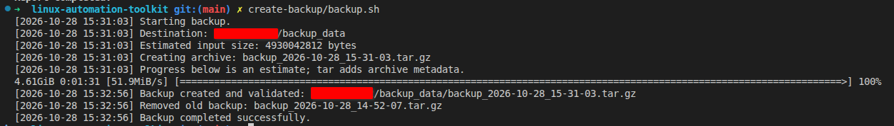
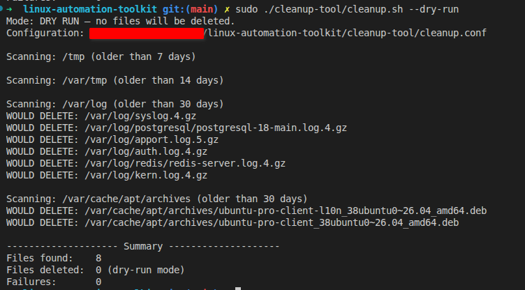
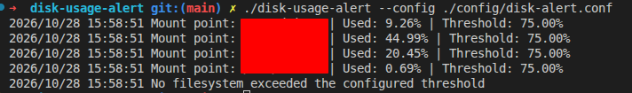
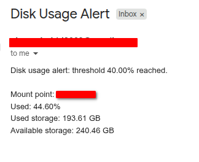
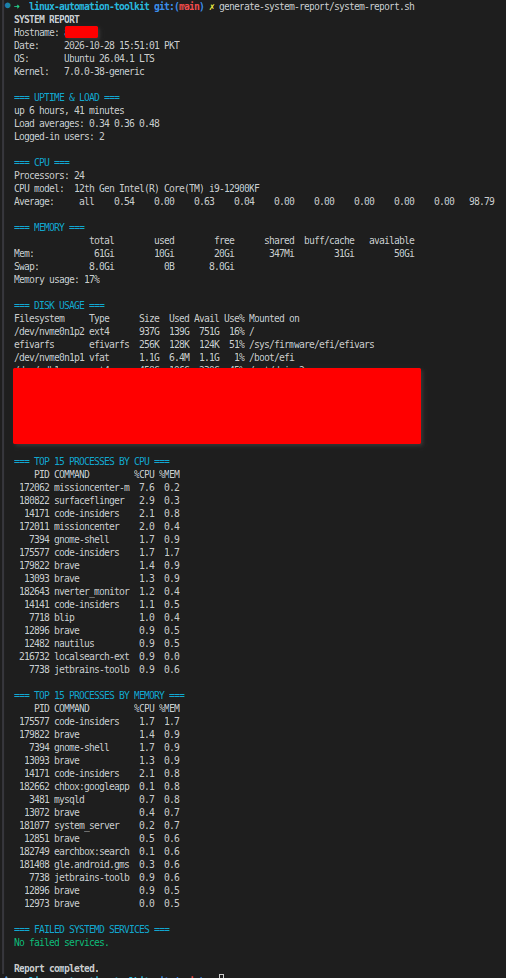
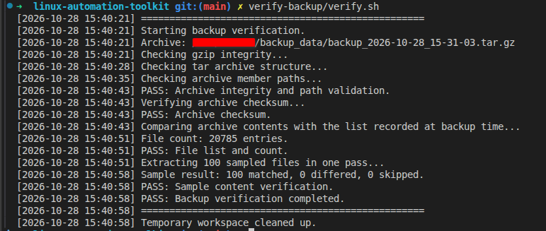
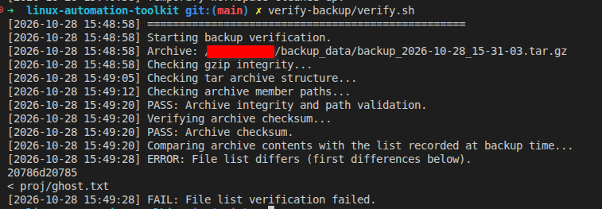

# Linux Automation Toolkit

A collection of Linux administration utilities for creating and restoring backups, verifying backup artifacts, monitoring disk capacity, mounting configured drives, cleaning old files, and generating system reports. Most tools are Bash scripts; `disk-usage-alert` is a Go application. Optional systemd units automate scheduled tasks.

## Repository contents

| Path                                                 | Purpose                                                                                                                                                    |
| ---------------------------------------------------- | ---------------------------------------------------------------------------------------------------------------------------------------------------------- |
| [`create-backup/`](create-backup/)                   | Creates timestamped `.tar.gz` archives, SHA-256 sidecar files, and archive file lists; applies retention; includes an interactive restore utility.         |
| [`verify-backup/`](verify-backup/)                   | Validates the newest matching archive, checks its checksum and recorded file list, then compares a sample of extracted files with configured live sources. |
| [`lib/`](lib/)                                       | Shared archive validation, temporary extraction, and comparison functions used by backup verification and restore.                                         |
| [`disk-usage-alert/`](disk-usage-alert/)             | Checks configured mount points and sends an SMTP email if a filesystem reaches the configured threshold.                                                   |
| [`check-drive-mount/`](check-drive-mount/)           | Mounts configured filesystems by UUID when they are not already mounted.                                                                                   |
| [`cleanup-tool/`](cleanup-tool/)                     | Finds old files in explicitly configured paths. Dry-run is the default; deletion requires `--execute`.                                                     |
| [`generate-system-report/`](generate-system-report/) | Prints a point-in-time system health report.                                                                                                               |
| [`timed-backup-service/`](timed-backup-service/)     | Example systemd service and timer for running a backup followed by verification.                                                                           |

Each tool has a dedicated README where available. Read it before configuring or scheduling that tool.

## Requirements

- Linux; Ubuntu/Debian are the primary documented examples.
- Bash and common GNU/Linux utilities.
- `systemd` for the supplied service/timer units.
- `tar`, `gzip`, `find`, `sort`, `realpath`, `flock`, `sha256sum`, `diff`, `cmp`, `grep`, and `shuf` for the relevant backup tools.
- `pv` for the backup progress display.
- Go 1.24 or newer to build `disk-usage-alert`.
- `sysstat` is optional for live CPU utilization in the system report.
- Root/sudo access is required for system-wide service installation and normally for mounting filesystems. Run other tools with the least privileges that can access their configured paths.

Install common utilities on Ubuntu/Debian:

```bash
sudo apt update
sudo apt install -y bash coreutils findutils tar gzip util-linux diffutils pv
```

## Get started

Clone the repository and enter it:

```bash
git clone <repository-url> linux-automation-toolkit
cd linux-automation-toolkit
```

Replace `<repository-url>` with your actual remote URL.

### Configure each tool

Copy the tracked example configuration to the exact filename expected by the corresponding script:

```bash
cp create-backup/example.conf create-backup/backup.conf
cp verify-backup/example.conf verify-backup/verify.conf
cp cleanup-tool/example.conf cleanup-tool/cleanup.conf
cp check-drive-mount/example.conf check-drive-mount/drive-mount.conf
cp disk-usage-alert/config/example.conf disk-usage-alert/config/disk-alert.conf
```

Review every path, UUID, retention setting, and threshold before running anything. Configuration files may contain machine-specific paths or credentials; do not commit real credentials. Restrict access to secret-bearing files:

```bash
chmod 600 disk-usage-alert/config/disk-alert.conf
```

Some configuration files use Bash arrays and are sourced by Bash scripts. Treat them as trusted shell configuration, not as safe files to load from an untrusted source.

### Run the tools

```bash
# Create a backup (requires create-backup/backup.conf)
./create-backup/backup.sh

# Validate and preview an archive before restoring
./create-backup/restore.sh --dry-run /path/to/backup_YYYY-MM-DD_HH-MM-SS.tar.gz

# Restore to a destination directory (interactive confirmation)
./create-backup/restore.sh /path/to/backup_YYYY-MM-DD_HH-MM-SS.tar.gz /path/to/restore

# Verify the newest matching backup
./verify-backup/verify.sh

# Preview cleanup; deletion is opt-in
./cleanup-tool/cleanup.sh
./cleanup-tool/cleanup.sh --execute

# Mount configured UUIDs
sudo ./check-drive-mount/mount-configured-drives.sh

# Generate a system report
./generate-system-report/system-report.sh

# Build and run disk-usage-alert
cd disk-usage-alert
go build -o disk-usage-alert ./cmd/disk-alert
./disk-usage-alert --config config/disk-alert.conf
```

The drive-mount and disk-alert commands depend on their configuration files and environment. See each tool's README for required setup and limitations.

## Screenshots









## Scheduling backups

`timed-backup-service/backup.service` and `backup.timer` are examples, not portable drop-in units: the service contains absolute paths and a specific user. Edit `ExecStart`, `ExecStartPost`, and `User` to match the checkout and account on the target machine. Verify that both scripts work manually as that user before enabling the timer.

```bash
sudo install -m 644 timed-backup-service/backup.service /etc/systemd/system/backup.service
sudo install -m 644 timed-backup-service/backup.timer /etc/systemd/system/backup.timer
sudo systemctl daemon-reload
sudo systemctl enable --now backup.timer
systemctl list-timers backup.timer
```

Inspect scheduled execution with:

```bash
sudo systemctl status backup.service --no-pager -l
sudo journalctl -u backup.service -n 100 --no-pager
```

The timer is configured for 02:00 local system time and `Persistent=true`; a missed run can be triggered when the timer becomes active again. The service runs backup creation and then verification. Ensure the verification configuration matches the backup configuration.

## Suggested operating sequence

1. Confirm configured data and backup filesystems are mounted.
2. Create a backup on a separate physical device or remote destination.
3. Verify the archive, checksum, file list, and sampled contents.
4. Monitor filesystem usage so the backup destination does not fill unexpectedly.
5. Review cleanup dry-run output before enabling deletion.
6. Periodically perform a restore into an isolated destination and inspect the restored files.

## Safety and operational notes

- A backup on the same physical disk as the source does not protect against disk failure. Prefer a separate disk or off-site/remote copy.
- A successful verification is not a substitute for a full restore test. The current verifier samples live source files and skips files that have changed since the archive timestamp.
- The restore script asks for confirmation, but extracted files can overwrite same-named files in the destination. Use a new, empty directory when possible.
- Cleanup is destructive when `--execute` is used. Review configured paths and age thresholds first.
- Confirm a configured drive is actually mounted at the intended mount point before writing backups. A path on an unmounted drive can silently refer to the underlying root filesystem; the backup script includes a root-filesystem guard but does not independently confirm a specific device UUID.
- Never commit passwords, app passwords, private keys, or real machine-specific configuration.
- Test systemd units with `systemd-analyze verify` and inspect the journal after installation.

## License

MIT License

Copyright (c) 2026 Ahsan Shahid
